<!-- Accent color: E8452C (朱色・仮). 差し替えるときは README.md / tools/gen_header.py / .github/workflows/snake.yml の E8452C を一括置換 -->

<p align="center">
  <picture>
    <source media="(prefers-color-scheme: dark)" srcset="./assets/header-dark.svg" />
    <source media="(prefers-color-scheme: light)" srcset="./assets/header-light.svg" />
    
  </picture>
</p>

<h1 align="center">やーはり <sub><sup>/ Yāhari</sup></sub></h1>

<p align="center">
  <code>Full-Stack</code> · <code>Infrastructure</code> · <code>Open Source</code> · <code>Japan 🇯🇵</code>
</p>

<p align="center">
  <a href="https://github.com/ibuki-hum4"></a>
  <a href="https://ya-hari.skyia.jp"></a>
  <a href="https://github.com/Senrijs/Senri"></a>
</p>

<p align="center">
  <a href="https://justuuid.pages.dev/u/976522a1-4bb1-4c51-9159-d325213011be" target="_blank" rel="noopener noreferrer">
    
  </a>
</p>

<p align="center">

[](https://技術者倫理.com)

</p>

---

## `$ whoami`

```console
$ cat ~/.profile
name        Yāhari (やーはり)
github      ibuki-hum4
location    Japan
role        Developer / Infrastructure Engineer

$ cat ~/interests
- Full-Stack Development
- Infrastructure Engineering
- Web Standards & Runtime Portability
- Identity & Authentication (OIDC)
- Open Source

$ echo $PHILOSOPHY
Build things that are useful, reliable, and maintainable.
```

I build software across the stack — from web frameworks and APIs to the Kubernetes clusters they run on.
I care about maintainability, type safety, performance, and practical engineering.

---

## `$ ls ~/projects`

<table>
  <tr>
    <td width="50%" valign="top">
      <h3><a href="https://github.com/Senrijs/Senri">Senri <sub>千里</sub></a></h3>
      <p>A lightweight TypeScript web framework built on Web Standards.<br/>Write once, run on any runtime.</p>
      <p>
        <code>Bun</code> <code>Deno</code> <code>Node.js</code> <code>Cloudflare Workers</code> <code>Service Workers</code>
      </p>
      <ul>
        <li><code>serve(app)</code> with runtime auto-detection</li>
        <li>Standard Schema validation</li>
        <li>Dev tools — error page &amp; <code>/_senri</code> dashboard</li>
        <li>Health checks &amp; graceful shutdown</li>
        <li>Error messages in English / 日本語</li>
        <li>Scaffold with <code>npm create senri</code></li>
      </ul>
      <p>
        <a href="https://github.com/Senrijs/Senri"></a>
        <a href="https://www.npmjs.com/package/@senrijs/senri"></a>
        <a href="https://jsr.io/@senrijs/senri"></a>
      </p>
    </td>
    <td width="50%" valign="top">
      <h3><a href="https://github.com/ibuki-hum4/HoshID">HoshID</a></h3>
      <p>Self-hosted identity provider (IdP) for authentication and membership management.</p>
      <p>
        <code>Better Auth</code> <code>OpenID Connect</code> <code>OAuth 2.0</code> <code>Kubernetes</code>
      </p>
      <ul>
        <li>OIDC provider for the Skyia community</li>
        <li>SSO for internal services (e.g. Outline wiki)</li>
        <li>Designed to serve third-party services too</li>
      </ul>
      <p>
        <a href="https://github.com/ibuki-hum4/HoshID"></a>
      </p>
      <br/>
      <h3>Ippo <sub>一歩</sub> <code>planned</code></h3>
      <p>A React meta-framework built on Senri.<br/><em>千里の道も一歩から</em> — a journey of a thousand miles begins with a single step.</p>
    </td>
  </tr>
</table>

---

## `$ cat ~/stack`

<table>
  <tr>
    <td><b>Languages</b></td>
    <td>
      <picture>
        <source media="(prefers-color-scheme: dark)" srcset="https://skillicons.dev/icons?i=ts,js,go,ruby&theme=dark" />
        <source media="(prefers-color-scheme: light)" srcset="https://skillicons.dev/icons?i=ts,js,go,ruby&theme=light" />
        
      </picture>
    </td>
  </tr>
  <tr>
    <td><b>Frontend</b></td>
    <td>
      <picture>
        <source media="(prefers-color-scheme: dark)" srcset="https://skillicons.dev/icons?i=react,nextjs,tailwind,vite&theme=dark" />
        <source media="(prefers-color-scheme: light)" srcset="https://skillicons.dev/icons?i=react,nextjs,tailwind,vite&theme=light" />
        
      </picture>
    </td>
  </tr>
  <tr>
    <td><b>Runtime</b></td>
    <td>
      <picture>
        <source media="(prefers-color-scheme: dark)" srcset="https://skillicons.dev/icons?i=nodejs,bun,deno&theme=dark" />
        <source media="(prefers-color-scheme: light)" srcset="https://skillicons.dev/icons?i=nodejs,bun,deno&theme=light" />
        
      </picture>
    </td>
  </tr>
  <tr>
    <td><b>Infra</b></td>
    <td>
      <picture>
        <source media="(prefers-color-scheme: dark)" srcset="https://skillicons.dev/icons?i=docker,kubernetes,linux,nginx,githubactions,cloudflare&theme=dark" />
        <source media="(prefers-color-scheme: light)" srcset="https://skillicons.dev/icons?i=docker,kubernetes,linux,nginx,githubactions,cloudflare&theme=light" />
        
      </picture>
    </td>
  </tr>
  <tr>
    <td><b>Database</b></td>
    <td>
      <picture>
        <source media="(prefers-color-scheme: dark)" srcset="https://skillicons.dev/icons?i=postgres&theme=dark" />
        <source media="(prefers-color-scheme: light)" srcset="https://skillicons.dev/icons?i=postgres&theme=light" />
        
      </picture>
    </td>
  </tr>
</table>

<details>
<summary><b>Infrastructure details</b></summary>
<br/>

<p>
  
  
  
  
  
  
  
  
  
  
</p>

</details>

<details>
<summary><b>Other</b></summary>
<br/>

<p>
  
  
  
  
  
  
</p>

</details>

---

## `$ tail -f ~/focus.log`

```diff
+ Senri          shipping 0.2.x → designing 0.3.0 (API cleanup, typed RPC client)
+ HoshID         running identity infrastructure for the Skyia community
+ Kubernetes     bare-metal HA cluster, migrating to Envoy Gateway
+ Learning       Rust, Vue
```

| Focus | |
|---|---|
| **Application Architecture** | Designing maintainable and scalable applications |
| **Infrastructure Engineering** | Building and operating containerized environments |
| **Identity & Security** | Authentication, authorization, and identity standards |
| **Open Source** | Developing and maintaining software for the community |
| **Performance** | Finding bottlenecks and making things a little faster |

---

## `$ git log --stat`

<p align="center">
  
</p>

<p align="center">
  <picture>
    <source media="(prefers-color-scheme: dark)" srcset="https://streak-stats.demolab.com?user=ibuki-hum4&hide_border=true&background=0a0a0a&ring=E8452C&fire=E8452C&currStreakLabel=E8452C&sideLabels=e6e6e6&currStreakNum=e6e6e6&sideNums=e6e6e6&dates=999999" />
    <source media="(prefers-color-scheme: light)" srcset="https://streak-stats.demolab.com?user=ibuki-hum4&hide_border=true&background=ffffff&ring=E8452C&fire=E8452C&currStreakLabel=E8452C&sideLabels=0a0a0a&currStreakNum=0a0a0a&sideNums=0a0a0a&dates=6e7781" />
    
  </picture>
</p>

<p align="center">
  <picture>
    <source media="(prefers-color-scheme: dark)" srcset="https://github-readme-activity-graph.vercel.app/graph?username=ibuki-hum4&hide_border=true&bg_color=0a0a0a&color=e6e6e6&line=E8452C&point=ffffff&area=true&area_color=E8452C" />
    <source media="(prefers-color-scheme: light)" srcset="https://github-readme-activity-graph.vercel.app/graph?username=ibuki-hum4&hide_border=true&bg_color=ffffff&color=0a0a0a&line=E8452C&point=0a0a0a&area=true&area_color=E8452C" />
    
  </picture>
</p>

<p align="center">
  <picture>
    <source media="(prefers-color-scheme: dark)" srcset="https://raw.githubusercontent.com/ibuki-hum4/ibuki-hum4/output/snake-dark.svg" />
    <source media="(prefers-color-scheme: light)" srcset="https://raw.githubusercontent.com/ibuki-hum4/ibuki-hum4/output/snake-light.svg" />
    
  </picture>
</p>

---

<p align="center">
  <sub><code>senr/</code> — Building, learning, and improving — one commit at a time.</sub>
</p>
